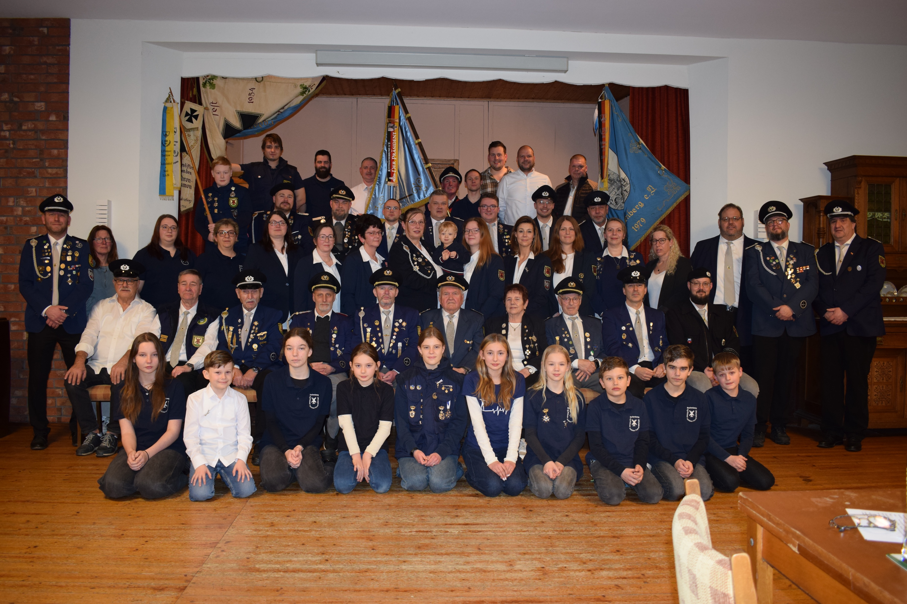

## Tradition trifft Moderne – Kameradschaft verbindet

Wir sind eine Gemeinschaft, die sich dem Schieß- und Bogensport betreibt und den Zusammenhalt großschreibt. Unser Vereinsgebäude wurde in den 80igern in Eigenleistung erbaut und besteht neben zwei großzügigen Aufenthaltsräumen aus einem Schießstand mit 50m Länge, auf dem Klein und Großkaliber geschossen werden kann. Der großzügige und vollständig überdachte Aussenbereich wird im Sommer von der Bogengruppe genutzt.

## unser Vorstand

| Name                | Funktion            |
| ------------------- | ------------------- |
| Dirk Michaelis      | 1. Vorsitzender     |
| Andrew Gieseler     | 2. Vorsitzender     |
| Sven Michaelis      | Kassenwart          |
| Luca Eckermann      | Schriftführer       |
| Claudia Bause       | 1. Frauenreferentin |
| JanineMüller        | 2. Frauenreferentin |
| Rene Pilz           | Jugendwart          |
| Christian Nienstedt | 1. Schießwart       |
| Andre Keufner       | 2. Schießwart       |
| Dominik Kunze       | 3. Schießwart       |
| Thomas Bause        | 1. Fähnrich         |
| Andy Fütterer       | 2. Fähnrich         |

## Was uns wichtig ist

Bei uns stehen Gemeinschaft, Kreativität und Spaß im Mittelpunkt. Wir möchten einen Ort schaffen, an dem sich jeder willkommen fühlt und seine Ideen einbringen kann. Ob du aktiv mitgestalten möchtest oder einfach nur dabei sein willst – bei uns ist Platz für alle!

## Unsere Aktivitäten

Bei uns ist immer etwas los! Zu unseren Highlights gehören:

- Wöchentliches Schießstraining
- Wöchentliches Bogensport Training
- Frauen Schießgruppe
- Regelmäßige Schützenfeste
- Jährliche Halloweenparty

Und das Beste: Wir haben jedes Jahr neue kreative Projekte, die für Begeisterung sorgen!

## Historie

Unser Verein existiert bereits seit 1874. Damals als „Vaterländischer Kriegerverein für Breitenberg gegründet, fand ca. 60Jahre später eine Fusion mit dem Kyffhäuserbund statt. 2024 wurde mit einem großen Festumzug das 150jährige Bestehen gefeiert. Aktuell besteht der Verein aus 215 Mitgliedern, darunter 25 Kinder und Jugendliche.

## Kontakt

Hast du Fragen oder möchtest mehr erfahren? Schreib uns gerne!

📧 E-Mail: [kyfbreitenberg@gmail.com]

📱 Folge uns auf [Social Media Links]

